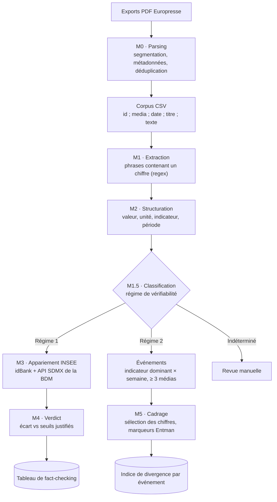

# Détecter la désinformation médiatique par la donnée

**Pipeline interprétable de vérification des chiffres de la presse française par confrontation aux séries de l'INSEE.**
Code du mémoire de recherche appliquée de Florian PRIVAT, MSc 2 Manager en Data Marketing, INSEEC, 2025-2026.

[](https://github.com/DJ-Papy/detection-desinformation-donnee/actions/workflows/tests.yml)

[](LICENSE)

> *English summary.* This repository contains the code of a French master's thesis asking to what extent media disinformation can be detected through data. A rule-based, interpretable pipeline extracts numerical claims from French press articles, sorts them into two "verifiability regimes", checks the verifiable ones against INSEE time series (SDMX API), and measures how outlets differ in which figures they select for the same event. On 562 articles (2023-2024), only about 5 % of figures were strongly verifiable and about 1 % could be matched to a dated official series. Documentation is in French.

---

## Sommaire

1. [La question et la réponse du mémoire](#1-la-question-et-la-réponse-du-mémoire)
2. [À lire avant d'utiliser ce code](#2-à-lire-avant-dutiliser-ce-code)
3. [Comment fonctionne le pipeline](#3-comment-fonctionne-le-pipeline)
4. [Installation](#4-installation)
5. [Démarrage rapide](#5-démarrage-rapide)
6. [Utiliser le pipeline sur son propre corpus](#6-utiliser-le-pipeline-sur-son-propre-corpus)
7. [Organisation du dépôt](#7-organisation-du-dépôt)
8. [Limites](#8-limites)
9. [Données et droits](#9-données-et-droits)
10. [Usage de l'intelligence artificielle](#10-usage-de-lintelligence-artificielle)
11. [Citer ce travail](#11-citer-ce-travail)

---

## 1. La question et la réponse du mémoire

**Question** : *dans quelle mesure peut-on détecter de la désinformation médiatique par la donnée ?*

Le mémoire part d'une distinction : tous les chiffres de presse ne se vérifient pas de la même façon.

| | Régime 1 : vérifiabilité forte | Régime 2 : vérifiabilité faible |
|---|---|---|
| **Quoi** | Un chiffre qui renvoie à une série officielle unique et datée | Un objectif, une prévision, une estimation, un ratio construit |
| **Exemple** | « Le taux de chômage s'établit à 7,4 % au T3 2023, selon l'Insee » | « Le gouvernement vise un déficit de 4,4 % du PIB en 2027 » |
| **Question possible** | *Est-ce vrai ?* → comparaison à l'INSEE | *Comment est-ce cadré ?* → comparaison entre médias |
| **Modules** | M3 (appariement INSEE) puis M4 (verdict) | M5 (analyse de cadrage) |

**Résultats publiés dans le mémoire** (corpus de 562 articles, 7 titres, 2023-2024) :

| Étape | Résultat | Section |
|---|---|---|
| Affirmations chiffrées extraites | 6 399 | §2.3.1 |
| Rattachées à un indicateur macroéconomique | 1 274 (20 %) | §2.3.2 |
| Régime 1 / régime 2 / indéterminé | 316 (5 %) / 5 058 (79 %) / 1 025 (16 %) | §2.4.1 |
| Série INSEE identifiée (idBank) | 292 sur 316 | §2.5 |
| Directement confrontables (mois ou trimestre précis) | ≈ 42, soit ≈ 1 % | §2.5 |
| Événements couverts par ≥ 3 médias | 27 | §2.6 |
| Indice de divergence des sélections (0 = mêmes chiffres, 1 = aucun en commun) | 0,80 en moyenne | §2.6 |

**Lecture** : la vérification automatique ne porte que sur une fraction marginale du discours chiffré ; l'essentiel relève du cadrage. Le mémoire est disponible dans [`docs/memoire/`](docs/memoire/).

## 2. À lire avant d'utiliser ce code

Trois points conditionnent ce que ce dépôt permet de faire. Ils sont détaillés dans [`docs/reproduire_les_resultats.md`](docs/reproduire_les_resultats.md).

1. **La version qui a produit les chiffres du mémoire n'a pas été conservée.** Le dépôt contient deux versions, visibles dans l'historique Git :
   - `v1.0.0` : le code tel qu'il existait le 22 juin 2026. Son classifieur surévaluait le régime 1 (67 % au lieu de 5 %).
   - `v2.0.0` : la version décrite dans le mémoire (§2.2 à §2.6), **réécrite en octobre 2026 à partir du texte**. Les règles sont celles du mémoire ; l'identité exacte des chiffres n'a pas pu être revérifiée.
2. **Le corpus n'est pas fourni.** Les articles Europresse sont protégés par le droit d'auteur. Le dépôt contient un corpus **fictif** de dix articles pour faire tourner le code, et la procédure pour reconstituer un corpus.
3. **Les pourcentages sont des ordres de grandeur.** Le classifieur de régimes n'a pas été validé contre un codage humain (protocole décrit au §2.4.2 et en Annexe 3, non exécuté). Plusieurs limites techniques, repérées en préparant cette publication, peuvent déplacer les chiffres exacts : voir [`docs/limites_connues.md`](docs/limites_connues.md).

## 3. Comment fonctionne le pipeline



| Fichier | Rôle | Choix méthodologique clé |
|---|---|---|
| [`module0_parser_europresse.py`](pipeline/module0_parser_europresse.py) | PDF Europresse → articles structurés | Contrôle par le nombre de mots annoncé par Europresse ; troncature au pied de page de copyright |
| [`module1_extraction.py`](pipeline/module1_extraction.py) | Repère les phrases porteuses d'un chiffre | Règles plutôt qu'apprentissage : chaque extraction est explicable |
| [`module2_structuration.py`](pipeline/module2_structuration.py) | Valeur, unité, indicateur, période, modificateurs | Lexique d'indicateurs explicite ; repli sur l'année de l'article (limite assumée) |
| [`module1_5_classifieur_regime.py`](pipeline/module1_5_classifieur_regime.py) | Régime 1, 2 ou indéterminé | Pas de régime 1 sans indicateur officiel ; une projection reste en régime 2 |
| [`module3_matching_insee.py`](pipeline/module3_matching_insee.py) | Série INSEE de référence et valeur officielle | Une série par indicateur, choisie et justifiée ([`docs/idbank_insee.md`](docs/idbank_insee.md)) |
| [`module4_validation_revise.py`](pipeline/module4_validation_revise.py) | Verdict de véracité | Seuil « confirmé » = max(arrondi du journaliste, incertitude INSEE) |
| [`evenements.py`](pipeline/evenements.py) | Regroupe les articles en événements | Indicateur dominant × semaine ISO, ≥ 3 médias distincts |
| [`module5_cadrage.py`](pipeline/module5_cadrage.py) | Compare les chiffres retenus par chaque média | Mesure inductive, sans profil éditorial posé a priori |
| [`pipeline_complet.py`](pipeline/pipeline_complet.py) | Enchaîne tout sur **un** événement | — |
| [`analyse_corpus.py`](pipeline/analyse_corpus.py) | Enchaîne tout sur **tout** le corpus et produit les chiffres de la Partie II | — |

Le détail (entrées, sorties, paramètres) est dans [`docs/architecture.md`](docs/architecture.md) ; les justifications dans [`docs/methodologie.md`](docs/methodologie.md).

## 4. Installation

Prérequis : Python 3.10 ou plus récent, Git.

```bash
git clone https://github.com/DJ-Papy/detection-desinformation-donnee.git
cd detection-desinformation-donnee
python -m venv .venv
source .venv/bin/activate          # Windows : .venv\Scripts\activate
pip install -r requirements-dev.txt
```

Seule dépendance d'exécution : `pdfplumber` (lecture des PDF). Le reste utilise la bibliothèque standard.

## 5. Démarrage rapide

Toutes les commandes se lancent **depuis la racine du dépôt**.

**Vérifier l'installation** (90 tests, sans réseau, environ une seconde) :

```bash
python -m pytest
```

Les 5 tests marqués `xfailed` sont normaux : ce sont des limites connues, écrites comme des tests qui échouent tant qu'elles ne sont pas corrigées.

**Faire tourner le pipeline sur un événement** (corpus fictif, valeurs INSEE simulées) :

```bash
python pipeline/pipeline_complet.py
```

```text
NIVEAU 1 — FACT-CHECKING (régime 1, vérifiable vs INSEE)
  [Quotidien Alpha   ] claim 7.4%     vs INSEE 7.4% → CONFIRMÉ (écart 0.0)
  [Quotidien Bêta    ] claim 7.5%     vs INSEE 7.4% → CONFIRMÉ (écart 0.1)
  [Journal Gamma     ] claim 7.9%     vs INSEE 7.4% → APPROXIMATIF (écart 0.5)
  [Agence Epsilon    ] claim 7.4%     vs INSEE 7.4% → CONFIRMÉ (écart 0.0)

NIVEAU 2 — CADRAGE (régime 2, analyse inter-médias)
  Articles pertinents : 4/4
  Indice de divergence des sélections : 0.89
```

**Produire les chiffres de la Partie II sur tout un corpus** :

```bash
python pipeline/analyse_corpus.py data/exemple/corpus_exemple.csv --comparer-memoire
```

Le rapport suit l'ordre du mémoire (§2.3 à §2.6) et, avec `--comparer-memoire`, affiche en regard les valeurs publiées. Les fichiers détaillés (`claims.csv`, `evenements.csv`, `synthese.json`) sont écrits dans `resultats/`.

**Interroger la vraie API INSEE** (accès Internet requis, sans compte ni clé) :

```bash
python pipeline/verifier_api_insee.py
```

## 6. Utiliser le pipeline sur son propre corpus

```bash
# 1. Diagnostiquer un export Europresse avant de l'intégrer
python pipeline/module0_parser_europresse.py mon_export.pdf

# 2. Parser un dossier d'exports, dédupliquer, écrire le corpus CSV
python pipeline/outil_corpus_stats.py data/corpus/ rapport.json data/corpus/corpus.csv

# 3. Analyser le corpus (option : vérifier les claims de régime 1 contre l'INSEE)
python pipeline/analyse_corpus.py data/corpus/corpus.csv --sortie resultats/ \
    --comparer-memoire --verifier-insee production

# 4. Analyse de sensibilité du cadrage
python pipeline/analyse_corpus.py data/corpus/corpus.csv --min-medias 4 --chiffres regime2
```

Le dossier `data/corpus/` est exclu de Git par `.gitignore` : vos articles ne seront pas publiés par erreur. Tout CSV contenant les colonnes `id`, `media`, `date` (AAAA-MM-JJ), `titre` et `texte` convient, quelle que soit la source ([`data/README.md`](data/README.md)).

## 7. Organisation du dépôt

```text
.
├── pipeline/                 code (un fichier par module, lancé depuis la racine)
├── tests/                    tests pytest, sans réseau (dont un PDF fictif généré à la volée)
├── data/
│   ├── README.md             format attendu, droits, reconstitution du corpus
│   └── exemple/              corpus fictif de 10 articles
├── docs/
│   ├── architecture.md       entrées, sorties et paramètres de chaque module
│   ├── methodologie.md       choix méthodologiques et leurs justifications
│   ├── reproduire_les_resultats.md
│   ├── limites_connues.md    limites, effet probable sur les chiffres, correctifs
│   ├── idbank_insee.md       séries INSEE retenues et comment les vérifier
│   └── memoire/              mémoire et annexes (PDF)
├── CHANGELOG.md              v1 → v2, et ce qui a été reconstruit
├── CITATION.cff
└── LICENSE
```

## 8. Limites

Les principales, détaillées avec leur effet probable sur les chiffres dans [`docs/limites_connues.md`](docs/limites_connues.md) :

- **Pas de validation humaine** du classifieur (κ de Cohen non calculé) : le 5 % est un ordre de grandeur.
- **Extraction** : un chiffre suivi d'une année (« 0,9 % en 2023 ») est écarté comme s'il s'agissait d'une date ; cela retire précisément des chiffres datés, donc parmi les plus vérifiables.
- **Indice de divergence** : calculé article par article (deux articles d'un même média comptent comme deux sélections) et sur tous les chiffres de chaque article, sans comparaison à un niveau de référence. La divergence de 0,80 mesure donc en partie l'hétérogénéité des articles et pas seulement un choix éditorial.
- **Périmètre** : presse écrite, indicateurs macroéconomiques, 2023-2024. Ce n'est pas un détecteur de désinformation au sens strict : le pipeline ne mesure ni l'intention ni la véracité des chiffres de régime 2.

## 9. Données et droits

- **Corpus Europresse** : non distribué. Les articles appartiennent à leurs éditeurs ; les contrats d'accès Europresse des bibliothèques encadrent strictement la fouille de textes et le téléchargement massif. Vérifiez les conditions de votre établissement avant toute collecte.
- **Données INSEE** : publiques, réutilisables sous Licence Ouverte (Etalab), interrogées via le service web SDMX de la BDM.
- **Corpus d'exemple** : entièrement fictif (médias, titres et textes inventés), placé sous licence MIT avec le code.

## 10. Usage de l'intelligence artificielle

Conformément à la note figurant dans le mémoire (p. 69), des assistants d'IA ont aidé à générer et déboguer le code du pipeline, puis à préparer cette publication (reconstruction de la version 2 d'après le mémoire, tests, documentation). Les décisions de fond relèvent de l'auteur : collecte manuelle du corpus, cadre des deux régimes, seuils de tolérance, choix des séries INSEE, règles de classification et interprétation des résultats.

## 11. Citer ce travail

Le fichier [`CITATION.cff`](CITATION.cff) fournit la référence au format attendu par GitHub (bouton *Cite this repository*). Pour citer le mémoire :

> PRIVAT, F. (2026). *Détecter la désinformation médiatique par la donnée. Vérification automatisée des chiffres de la presse française par recoupement avec les sources officielles* [Mémoire de recherche appliquée, MSc 2 Manager en Data Marketing]. INSEEC.

## Licence

Code et corpus fictif : [MIT](LICENSE). Le mémoire et ses annexes (`docs/memoire/`) **ne sont pas** sous licence MIT : tous droits réservés à l'auteur.
